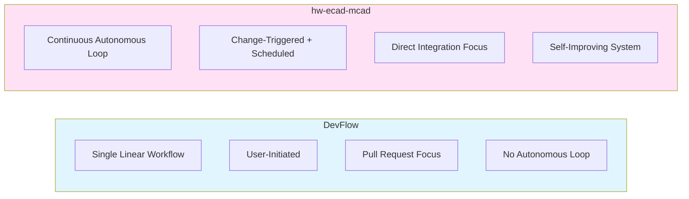
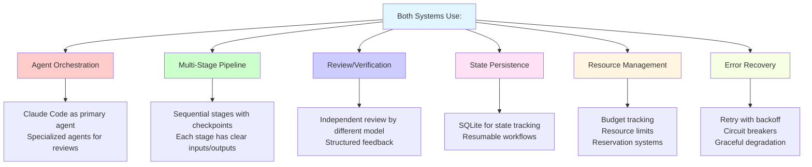
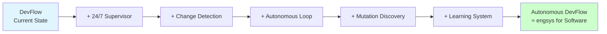

# Architectural Comparison: DevFlow vs hw-ecad-mcad

## Side-by-Side Workflow Comparison

```mermaid
graph TB
    subgraph DevFlow ["DevFlow (Software Development)"]
        D1[User Request:<br/>devflow dev 'task']
        D2[Stage 1: DEVELOP<br/>Claude Code Agent]
        D3[Stage 2: REVIEW<br/>4 Parallel Reviewers:<br/>Quality, Security,<br/>Architecture, Tests]
        D4[Stage 3: SYNTHESIS<br/>Opus 4.5<br/>Consolidate Reviews]
        D5[Stage 4: CREATE_PR<br/>GitHub Integration]
        D6[SQLite State DB<br/>Workflow Tracking]

        D1 --> D2
        D2 --> D3
        D3 --> D4
        D4 --> D5
        D2 -.-> D6
        D3 -.-> D6
        D4 -.-> D6
    end

    subgraph HW ["hw-ecad-mcad (Hardware Engineering)"]
        H1[Trigger:<br/>Code Change, Schedule,<br/>Manual Task]
        H2[OBSERVE/DISCOVER<br/>Detect Changes<br/>Mutation Scan]
        H3[IMPLEMENT<br/>Claude Code Agent<br/>in Sandbox]
        H4[VERIFY + REVIEW<br/>Test Engine<br/>+ Independent Reviewer]
        H5[INTEGRATE<br/>Git Commit<br/>with Revert Safety]
        H6[SQLite State DB<br/>Task Queue<br/>Evidence Store]
        H7[LEARN<br/>Metrics + Memory]

        H1 --> H2
        H2 --> H3
        H3 --> H4
        H4 --> H5
        H5 --> H7
        H7 --> H2
        H2 -.-> H6
        H3 -.-> H6
        H4 -.-> H6
        H5 -.-> H6
    end

    style D2 fill:#ffcccc
    style D3 fill:#ccffcc
    style D4 fill:#ccccff
    style H2 fill:#e1f5ff
    style H3 fill:#ffcccc
    style H4 fill:#ccffcc
    style H5 fill:#fff5e1
```

## Architectural Similarities

| Component | DevFlow (Software) | hw-ecad-mcad (Hardware) |
|-----------|-------------------|------------------------|
| **Primary Agent** | Claude Code for development | Claude Code for implementation |
| **Review System** | 4 specialized reviewers (Quality, Security, Architecture, Tests) | Verification Engine + Independent Review Agent |
| **Synthesis** | Opus 4.5 consolidates reviews | Independent reviewer (different model/role) |
| **State Management** | SQLite database (`StateManager`) | SQLite WAL database (`engineering/var/state.db`) |
| **Workflow Stages** | develop → review → synthesis → create_pr | observe → plan → implement → verify → review → integrate → learn |
| **Integration** | GitHub PR creation with comments | Git commit with automatic revert on regression |
| **Configuration** | `.devflow.toml` (hierarchical) | `hwplatform.toml` + `engsys.toml` |
| **Autonomy Levels** | Configurable review requirements | 3 levels (Auto, Supervised, Restricted) |
| **Background Execution** | Workflow orchestrator | 24/7 supervisor with worker threads |
| **Recovery** | State persistence for resuming | Orphan recovery, lease expiry, watchdog service |

## Key Differences

### DevFlow Characteristics
- **User-driven**: Each workflow run is explicitly initiated
- **Linear pipeline**: develop → review → synthesis → PR
- **GitHub-centric**: Outputs pull requests with review comments
- **Stateful but not autonomous**: Tracks runs but doesn't self-improve
- **Software development domain**: Code quality, security, architecture

### hw-ecad-mcad Characteristics
- **Autonomous operation**: Continuous 24/7 operation with supervisor
- **Cyclic workflow**: OBSERVE → IMPLEMENT → VERIFY → INTEGRATE → LEARN → OBSERVE
- **Git-centric**: Direct commits with traceable Task-Id
- **Self-improving**: Mutation scanning discovers gaps, agents fix them
- **Hardware engineering domain**: Geometric verification, ECAD/MCAD correspondence

## Shared Design Patterns

## Evolution Path: DevFlow → Autonomous DevFlow

The hw-ecad-mcad engineering system (`engsys`) demonstrates what DevFlow could become with autonomous operation:

### Potential Enhancements for DevFlow

Based on hw-ecad-mcad's engineering system:

1. **Continuous Operation**
   - Supervisor process for 24/7 monitoring
   - Watchdog service for automatic restart
   - File system monitoring for change detection

2. **Autonomous Discovery**
   - Code coverage gap detection
   - Automatic issue detection from logs
   - Technical debt scanning

3. **Self-Improvement Loop**
   - OBSERVE: Detect changes or gaps
   - PLAN: Create improvement tasks
   - IMPLEMENT: Agent fixes issues
   - VERIFY: Run tests + reviews
   - INTEGRATE: Auto-commit if safe
   - LEARN: Update quality metrics

4. **Enhanced Resource Management**
   - Budget reservation system (time, API calls, cost)
   - Circuit breakers for failing operations
   - Provider failover and backoff

5. **Autonomy Levels**
   - Level 1: Auto-integrate (tests, docs, low-risk fixes)
   - Level 2: Verify + await approval (core code, APIs)
   - Level 3: Block without pre-authorization (security, licenses)

6. **Evidence Trail**
   - Structured evidence storage
   - Traceable git commits with Task-Id
   - Memory system for lessons learned
